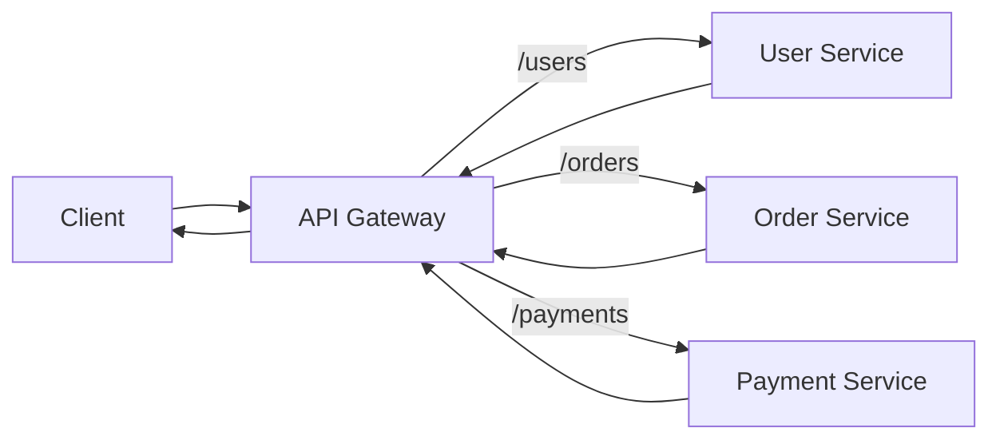

# API Gateway

## Overview

- Single entry point for client requests
- Routes requests to backend services
- Separates external APIs from internal systems
- Reduces client complexity and coupling
- Handles shared concerns
  - Authentication
  - Rate limiting
  - Caching
  - TLS termination
  - Logging

## Request Flow



1. Gateway checks and routes each request
2. Backend services handle business logic
3. Response returns through the gateway

## Responsibilities

- Request Validation

  - Validate paths, headers, and request bodies
  - Enforce schemas
  - Reject malformed requests early
- Middleware

  - Authentication and authorization
  - Rate limiting
  - IP allow and deny lists
  - Request logging
  - Header normalization
- Routing

  - Route by path, method, header, or query parameter
  - Example

    ```yaml
    routes:
      - path: /users/*
        service: user-service
        port: 8080
      - path: /orders/*
        service: order-service
        port: 8081
      - path: /payments/*
        service: payment-service
        port: 8082
    ```
- Backend Communication

  - Forward requests securely
  - Translate protocols, such as HTTP to gRPC
  - Apply timeouts and retries
  - Perform basic load balancing
  - Preserve tracing headers
- Response Transformation

  - Convert internal responses to client formats
  - Example: backend gRPC response to client JSON
- Caching

  - Reduce backend load and improve latency
  - Strategies
    - Full or partial response caching
    - TTL-based expiration
    - Event-based invalidation
  - Storage
    - In-memory
    - Redis
    - CDN

## Security

- Authentication
  - OAuth 2.0
  - JWT
  - API keys
  - Mutual TLS (mTLS)
- Authorization
  - Role-based access
  - Policy enforcement
  - Backend services still enforce their own resource permissions
- Encryption
  - Use TLS for traffic
  - Apply secure headers
- Protection
  - DDoS mitigation
  - Web Application Firewall (WAF)
  - Bot detection

## Scaling and Availability

- Horizontal scaling
  - Run multiple instances behind a load balancer
  - Use autoscaling
- Vertical scaling
  - Give each gateway instance more CPU or memory
  - Has hardware and cost limits
- Global scaling
  - Deploy across regions
  - Route with GeoDNS
  - Synchronize configuration
- High availability
  - Health checks
  - Failover routing
  - Rolling upgrades

## Observability

- Logging
  - Access logs
    - Requests, routes, status codes, and latency
  - Error logs
    - Failures and diagnostic details
  - Audit logs
    - Security-relevant actions and configuration changes
- Metrics
  - Latency
    - Time each request takes
  - Throughput
    - Requests handled per second
  - Error rate
    - Share of requests that fail
  - Cache hit rate
    - Share of requests served from cache
- Tracing
  - Distributed traces
    - Follow a request as it moves across services
  - Correlation IDs
    - Identify related logs and traces for one request

## Examples

- Managed Services
  - AWS API Gateway
    - AWS integrations
    - REST and WebSocket support
    - Usage plans and CloudWatch metrics
  - Azure API Management
    - OAuth and OpenID support
    - Policy engine and developer portal
  - Google Cloud Endpoints
    - gRPC support
    - OpenAPI support
- Open Source
  - Kong
    - NGINX-based
    - Plugin ecosystem
    - Service mesh support
  - Tyk
    - Go-based
    - GraphQL support
    - Built-in analytics
  - Gravitee
    - Design-first
    - Event-native APIs
    - Analytics portal

## Patterns and Tradeoffs

- Request Aggregation
  - Gateway calls multiple services and combines their responses
  - Reduces client round trips
- Backend for Frontend (BFF)
  - Use a separate gateway for each client type when their needs differ
  - Example: web app, mobile app, partner API
- Tradeoffs
  - Adds a network hop and can increase latency
  - Can become a bottleneck or single point of failure
  - Needs scaling, monitoring, and high availability
  - Keep business rules in backend services

## When to Use

- Microservice systems with multiple backend services
- Systems needing a shared entry point for security or traffic policies

## When Not to Use

- Simple monoliths
- Single-backend applications
- Low-traffic internal tools
- Early prototypes and MVPs

## Best Practices

- Keep the gateway stateless
- Avoid heavy business logic
- Version APIs
- Enforce quotas
- Document routes
- Monitor performance
- Secure administrative access
- Automate configuration
